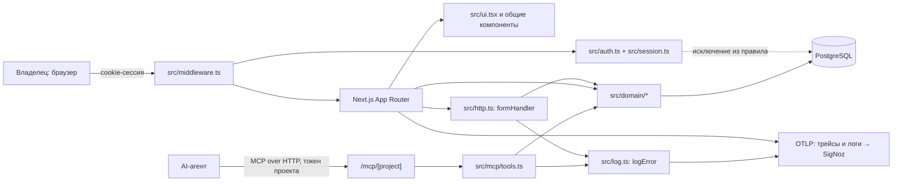

# Архитектура

Next.js 16 (App Router) + Prisma 7 + PostgreSQL. Один процесс отдаёт и веб-интерфейс
владельца, и MCP-сервер для агентов. Деплой — Coolify, docker compose buildpack.

Слои:

| Слой | Где | Отвечает за |
|---|---|---|
| Страницы владельца | `src/app/**/page.tsx`, `layout.tsx`, локальные `tree.tsx`, `tiles.tsx`, `globals.css`, `icon.svg` | server components, рендер списков и форм |
| Общие UI-компоненты | `src/ui.tsx` (ядро: `Markdown`, `Icon`, `ProjectNav`, `Head`, `Banner`, `Reveal`, метки статуса и приоритета, форматирование дат), `src/header.tsx`, `src/confirm.tsx`, `src/copy.tsx`, `src/filter.tsx`, `src/trend.tsx` | переиспользуемая вёрстка страниц; сюда смотреть перед тем, как писать свой компонент |
| Контракт route handlers | `src/http.ts` | `formHandler` (сессия, `DomainError` → баннер, безопасный `back` через `internalPath`), `redirect`, `text`, `optional`; от него зависят все маршруты API |
| HTTP API | `src/app/api/*/route.ts` | мутации из UI (tasks, documents, projects, tokens, session) |
| MCP | `src/app/mcp/[project]/route.ts`, `src/mcp/server.ts`, `src/mcp/tools.ts` | инструменты агента (19 в `TOOLS`); проект берётся из токена |
| Аутентификация владельца | `src/auth.ts` (пароль, старт и конец сессии), `src/session.ts` (подпись и проверка куки, `SESSION_COOKIE`), `src/middleware.ts` (охрана всех маршрутов кроме `/login`, `api/session`, `mcp`, `_next`, `favicon.ico`; разовая выдача токена), `src/login-limit.ts` (лимит попыток входа, счётчик в памяти процесса) | вход владельца и удержание сессии |
| Заголовки безопасности | `next.config.ts` (`headers()`) | CSP c `frame-ancestors 'none'`, `X-Frame-Options: DENY`, `X-Content-Type-Options: nosniff`, `Referrer-Policy: strict-origin-when-cross-origin` на всех путях; HSTS отдаётся при `ENABLE_HSTS=1` — в проде включён (`max-age=31536000; includeSubDomains`) |
| Домен | `src/domain/*` | задачи, документы, дерево, комментарии, проекты, токены, авторство, ошибки |
| Данные | `prisma/schema.prisma`, `src/db.ts` | Owner, Project, Token, Task, Comment, Document |
| Сгенерированный клиент Prisma | `src/generated/prisma` | вывод `prisma generate`; в `.gitignore`, руками не правится и в обзор изменений не попадает |
| Телеметрия | `src/instrumentation.ts`, `src/log.ts` | OTel-экспорт трейсов (`/v1/traces`) и логов (`/v1/logs`, `BatchLogRecordProcessor`) в SigNoz; без `OTEL_EXPORTER_OTLP_ENDPOINT` молчит. `logError()` пишет severity ERROR с `exception.type/message/stacktrace` и контекстом (`http.route` из `src/http.ts`, `mcp.tool`/`mcp.project` из `src/mcp/server.ts`), `console.error` сохранён |
| Страница-объяснялка | `agents.html` (корень репозитория, 42 KB) | самостоятельный HTML вне Next.js: как агенты работают с Deckbook; сборкой не используется |

Домен задач разложен по швам — четыре модуля вместо одного горячего файла,
публичные имена собраны реэкспортом в `tasks.ts`, потребители импортируют оттуда:

| Модуль | Отвечает за |
|---|---|
| `src/domain/task-values.ts` | статусы, приоритеты, их разбор, работа с датой срока, условие `DUE_NOW` |
| `src/domain/task-queries.ts` | чтения задач и форма дерева |
| `src/domain/task-stats.ts` | счётчики плиток, ряд для графика, `backlogTrend()` по всем проектам одним запросом |
| `src/domain/tasks.ts` | изменения задач: создание, статус, назначение, повторение |

Границы: MCP и UI не ходят в базу мимо `src/domain/*`; проект — граница доступа
агента (D-0003), токен за неё не выходит. Единственное исключение из правила про
домен — `src/auth.ts`: он обращается к `prisma.owner` напрямую, потому что владелец
и его сессия существуют до и вне любого проекта, а домен весь построен вокруг
проекта. Других файлов с прямым доступом к Prisma вне `src/domain/*` быть не должно
— новый такой файл означает либо ошибку, либо новую строку в этом абзаце.

Тесты идут против общей базы `deckbook_test`, а `tests/setup.ts` в `beforeEach`
делает `TRUNCATE` — поэтому два одновременных прогона (например из соседних
агентских worktree) затирали данные друг у друга. `tests/global-setup.ts` берёт
session-scoped `pg_advisory_lock` на выделенном соединении: параллельные прогоны
встают в очередь, а не мешают друг другу. Страховка от случайного удаления
`globalSetup` — `tests/db-lock.test.ts`.

## Прод

| | |
|---|---|
| Адрес | `https://deckbook.chatindex.app` (маршрут задаёт `docker_compose_domains` в Coolify через `SERVICE_FQDN_APP_3000`; поле `fqdn` в UI не редактируется и ни на что не влияет) |
| TLS | Let's Encrypt, `CN=deckbook.chatindex.app`, до 2026-10-29 |
| Хост | единственный сервер Coolify `49.13.201.1` (Hetzner): 24 приложения, 22 БД, 6 сервисов, один общий Traefik |
| Доступ агента к Coolify | read-only MCP (`get_*`/`list_*`) — правки в панели делает владелец |
| Публичные страницы | одна: `/login`; `/` → 307 на неё |

Известное ограничение хоста: у **всех** сайтов сервера периодически синхронно
рвутся соединения (`read ECONNRESET`, местами 503/504) окнами по 1–2 часа —
запросы не доходят до приложений, SigNoz в это время видит 0 ошибок,
`restart_count: 0`. Ошибка не в приложении: `logs/2026-08-05`, задача
`cmsgfnyii002y01ljmoq112tg`. Любой даун `deckbook.chatindex.app` сначала
проверяется против остальных мониторов хоста.

Мониторинг: Uptime Kuma (доступность, часовая рутина `check-uptime`),
SigNoz (трейсы, логи, ошибки, p99), Coolify (статус контейнера).
Baseline трафика: 82 594 запроса за сутки 2026-08-05/06, error rate 0.0%,
p99 худшего маршрута 214 мс (`GET /projects/[slug]/tasks/[id]`).

## Решения

| № | Решение | Источник |
|---|---|---|
| D-0001 | Эпики, подзадачи и шаблоны — одна сущность Task; тип работы не хранится | `docs/adr/0001` |
| D-0002 | Историй изменений и версий документов не существует; запись затирает предыдущую | `docs/adr/0002` |
| D-0003 | Проект — граница доступа агента; токен выдаётся на проект | `docs/adr/0003` |
| D-0004 | Срок прячет задачу до наступления дня — и от агента, и из «Моих задач» владельца (галочка «Показывать отложенные» возвращает их) | `docs/adr/0004` |
| D-0005 | Миграции вместо `db push` | `docs/adr/0005` |
| D-0006 | Шаблонов задач нет — флаг `isTemplate` удалён | `docs/adr/0006` |
| D-0007 | Цель проекта — свободный текст, агент только читает | `docs/adr/0007` |

Полные тексты решений живут в репозитории (`docs/adr/`) — их читают инженерные
скиллы. Здесь только реестр: новое решение сначала ADR в репо, потом строка сюда.
